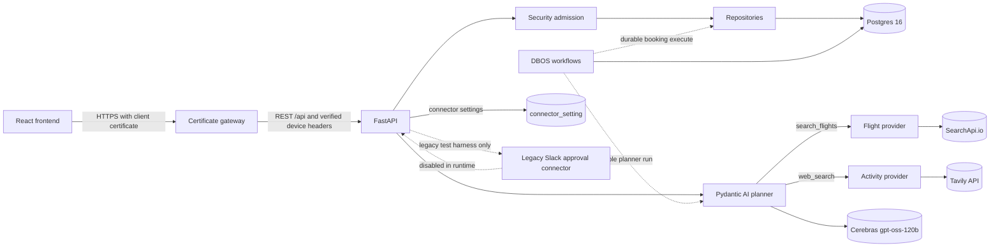

# TravelOps Agent

A bounded **zero-trust application prototype**, using a stateful travel planner as
the protected resource. It demonstrates user/session verification, role and tenant
access policy, privileged MFA, recorded security decisions, and automatic session
containment. It is a first implementation toward the enterprise-network project
objective; the isolated deployment adds certificate possession and private service networks.
Deployment-level verification still requires Docker.

The planner searches flights and destination activities and proposes an itinerary.
Booking approval and execution stay outside the model's tools, behind application
policy and a human-approval state machine. The system returns checkout links;
it does not purchase flights.

The [architecture findings](docs/ZERO_TRUST_FINDINGS.md) preserve the baseline,
before/after evidence, design limits and three-scenario security demonstration.

## Zero-trust architecture

Zero-trust enforcement is mandatory; `ZERO_TRUST_ENFORCED=false` fails startup. Every protected
API route requires a verified session, supplied through a browser cookie or short-lived bearer
token. The local issuer uses custom HMAC-signed tokens,
passwords, and TOTP; it does not implement OIDC discovery or standard OIDC token validation.
With no `ZERO_TRUST_SIGNING_SECRET` set, the app generates a fresh per-process signing key; set an explicit secret
for a deployment whose tokens must survive a restart. Production should put Keycloak or another
OIDC provider in front of the API and use mTLS/service-mesh identity for internal traffic.

The SPA signs in through `POST /api/auth/browser/login` and
`POST /api/auth/browser/mfa`. The API sets a 15-minute HttpOnly, SameSite=Strict cookie;
browser responses omit the bearer token. Requests include cookies, and browser writes
must send the configured `FRONTEND_ORIGIN`. HTTPS is required outside loopback development;
use the same site for the frontend and API so Strict cookies are sent. The original
`/api/auth/login` and `/api/auth/mfa` endpoints remain available to bearer-token CLI clients.
Set `ZERO_TRUST_SIGNING_SECRET` and use the seeded demo credentials or a
local user; MFA-enabled users must complete the TOTP step. Connector settings are deployment-wide,
not tenant-owned, and both reading and changing them require the `security-operator` or `admin` role
plus verified MFA.

Slack approval callbacks and notifications are disabled while enforcement is enabled, even
with credentials configured. Slack users are not mapped to trip owners or verified application
sessions; approve and cancel bookings in the app. The legacy Slack flow is test-only.

Device IDs demonstrate consistency between submitted and stored identity attributes; they do not
prove device health or hardware attestation. The isolated deployment adds mutual TLS
and private service networks; see [deployment instructions](#running-it). See the [trust boundaries](docs/ARCHITECTURE.md#zero-trust-enterprise-network-overlay).

## Start here

- [Architecture](#architecture): the system boundary and critical request path.
- [Zero Trust control plane](docs/ARCHITECTURE.md#zero-trust-enterprise-network-overlay): how the
  five required areas (identity and access management, MFA, segmentation, continuous monitoring,
  incident response) map to concrete controls, and what is deliberately out of scope.
- [Zero-trust demo](#zero-trust-demo): deterministic identities, MFA, attacks, containment, and
  security-operations queries.
- [Engineering decisions](docs/DECISIONS.md): deeper rationale and trade-offs.
- [Security evaluation](docs/SECURITY_EVALUATION.md): PostgreSQL validation, repeatable scenarios,
  and a modest local latency comparison.

There is no public hosted demo yet. Run the local stack below, or use the walkthrough as a short
recorded demo script. The project intentionally does not present itself as a production travel
service: it does not purchase flights and has not had production-scale load testing or an
independent security audit.

## Zero-trust demo

Follow [deployment setup](#running-it) first, including the private environment secrets.
For the synthetic walkthrough, issue both devices before starting the gateway:

```bash
python3 deploy/issue-device.py device-a-traveler
python3 deploy/issue-device.py device-a-operator
docker compose -f compose.zero-trust.yml up --build -d
docker compose -f compose.zero-trust.yml run --rm migrate python -m scripts.seed_security_demo
cd backend
uv sync
baml generate
uv run python -m scripts.security_demo
```

Stop API writers while applying migration `5d9f1b3c4e67`; deploy the updated API
and frontend together. This migration clears fixed-salt password hashes and revokes their sessions.
It preserves account ownership and modern password hashes. Cleared hashes cannot be
restored by downgrade; those accounts must enroll a new password.
For an existing account left with an empty password hash, run
`uv run python -m scripts.enroll_identity --email <email> --provisioning-file <private-new-file>`
from `backend` as a trusted database operator. This provisions a unique authenticator and
revokes previous sessions while preserving ownership and policy. Import the private URI into
an authenticator and remove the file. Migration `6e0a2c4d8f10` retires the public shared TOTP
secret and its sessions; already password-enrolled accounts need `--reset-mfa` to provision
a replacement authenticator. Synthetic demo seeds explicitly retain public demo credentials.
Login, MFA, and protected requests require the registered client certificate through the
gateway described in [deployment instructions](#running-it).

The synthetic accounts all use `demo-password` and the TOTP secret
`JBSWY3DPEHPK3PXP` (the script calculates the current six-digit code).
Each identity can consume a code only once; wait for the next 30-second code before
repeating MFA sign-in, including when rerunning the demo. The demo shows a valid
tenant-scoped request, MFA-gated operator access, token/session rejection,
browser segment spoof rejection, denials triggering session revocation, and the
security-operations event/incident query. These are throwaway demo credentials; never reuse them.

For the repeatable PostgreSQL demonstration, including authorized booking, cross-tenant denial,
tampered tokens, revocation, and completed planner exchanges retained after a later model failure, follow
the [evaluation commands](docs/SECURITY_EVALUATION.md). That harness uses isolated test data and
stubbed external providers; it does not purchase flights or consume model/search quota.
If the booking-options provider is unavailable, execution stays confirmed and the user can retry;
the app does not create a terminal handoff without checkout links.

## Security demonstration

Use three scenarios to show the bounded prototype:

1. **Legitimate access:** a traveler completes MFA and reads an owned trip. A
   password-only session cannot approve a booking.
2. **Unauthorized access and containment:** a tenant-A traveler attempts to read
   tenant B's booking. Five denied reads trigger session revocation; the next
   protected request with that token returns 401.
3. **Operator evidence:** an MFA-verified operator inspects the linked incident
   and assessment evidence. Show pass, fail and insufficient evidence honestly;
   a database-owner application role should fail the audit-protection assessment.

The [findings document](docs/ZERO_TRUST_FINDINGS.md#presentation-scope-and-three-scenario-demonstration)
maps these scenarios to actual tests and explains the before/after design. With
an isolated PostgreSQL test database prepared as described in
[Security evaluation](docs/SECURITY_EVALUATION.md#repeat-the-validation), run from `backend`:

```bash
uv run pytest -q tests/test_security_integration.py tests/test_compliance.py
```

These tests use synthetic accounts and stub external providers. They do not
purchase flights or spend model/search quota. The standalone HTTP script above
is a smaller missing-resource walkthrough; it does not cover the full
cross-tenant assessment scenario. Browser rehearsal remains separate work.

## Architecture



The critical boundary is deliberate: the LLM researches and proposes; deterministic application
code owns booking state, durability, and accountability.

See [the detailed request path and durability model](docs/ARCHITECTURE.md#the-critical-request-path)
for the DBOS workflow boundary and replay behavior.

Booking state, audit guarantees, provider failure behavior, and DBOS recovery are documented in
the [architecture](docs/ARCHITECTURE.md) and [decisions](docs/DECISIONS.md) docs.

## Project status and limitations

Security monitoring now includes recurring MFA, audit-protection, and session-containment checks.
See [implementation, findings, and demonstration steps](docs/COMPLIANCE_MONITORING.md).

This is a portfolio and reference implementation intended for local development and evaluation.
It is not a production travel service; testing includes only modest local load, with no independent
security audit. The local password/TOTP issuer and tenant/owner checks are bounded demonstration
controls, not a production identity or device-management system. Activity citations show that a URL came from the
configured search provider; they do not independently verify every generated claim. The booking
flow returns third-party checkout links and does not reserve, purchase, or hold a fare.

See the [trust boundaries](docs/ARCHITECTURE.md#zero-trust-enterprise-network-overlay) for the
detailed runtime, security, recovery, and integration limitations.

## What it does

1. **Plan a trip:** origin, destination, dates, age, and fitness level are all required at
   intake. It can still ask a clarifying question if a provided value is ambiguous.
2. **Search flights:** SearchApi.io Google Flights results in live-provider mode, with
   route-and-date caching; recorded fixtures are available for repeatable tests.
3. **Generate an attributed itinerary:** the agent researches activities through Tavily and
   returns a day-by-day plan. Each activity must cite a URL returned by that run's web search.
4. **Human-approved booking handoff:** review a proposed flight, explicitly approve it, then
   retrieve real checkout links, as three separate steps. Nothing here books a flight. Approval
   unlocks a deterministic, audited workflow whose output is airline/OTA checkout links with the
   chosen flight already attached; you complete the purchase on the carrier's own site, and the
   reference this app stores is its own audit id, not an airline confirmation number. Because no
   fare is actually held, a 30-minute freshness window guards against handing you a stale price:
   approving or executing past it marks the booking `EXPIRED` and asks you to search again.
5. **Review execution and approvals:** trip planners and admins have separate execution-history
   and approval-history tabs, scoped to their own trips. Execution history includes tool calls,
   token usage, timing, and page controls. Approval history reads the append-only booking trail.
   Travelers retain their trip's live activity and booking controls without these history tabs.
6. **Revisit any past trip:** a "Your trips" tab lists everything you've created, newest first
   and filterable by date range. Trips remain in Postgres until their rows are removed.

## Stack

- **Backend:** FastAPI, Pydantic AI, SQLModel/asyncpg, PostgreSQL 16, Alembic, DBOS (durable
  workflow execution, reuses the same Postgres instance).
- **LLM:** Cerebras `gpt-oss-120b` via Pydantic AI.
- **Flights:** SearchApi.io Google Flights structured responses, or recorded fixtures.
- **Activities:** Tavily web search.
- **Frontend:** React 19 + Vite + Tailwind CSS v4, TypeScript. A structured trip form drives the
  agent; a live activity feed polls for its tool calls on the trip page, and a separate
  execution panel pages through run traces for owned trips. A "Your trips" tab lists the
  signed-in user's trips.

Live-provider operation requires accounts and API credentials for the configured services.
Availability, pricing, and quotas are controlled by those providers and can change. For why each
provider was selected, see [DECISIONS.md](docs/DECISIONS.md).

## Running it

Navigation follows the verified browser session's role. The sidebar has a separate button for
each available view and can collapse to icons; button labels remain available to assistive tools.

| Role | Available views |
| --- | --- |
| Traveler | Plan a trip, Your trips |
| Trip planner | Plan a trip, Your trips, Agent execution history, Approval history |
| Security operator | Connectors, Security monitoring (verified MFA required) |
| Platform operator | Security monitoring (verified MFA required) |
| Admin | All views; Connectors and Security monitoring require verified MFA |

History collection APIs enforce dedicated role permissions, and security/connector APIs enforce
role and MFA policy. Hidden panels are not mounted or fetched. Individual trip activity and
booking actions still require ownership. Flight search prefers nonstop round-trip options and
falls back to connecting offers when no nonstop outbound candidate can form a complete round
trip. The UI labels stops separately for each direction and keeps connecting offers selectable.

The enforced deployment uses `compose.zero-trust.yml`. It builds the frontend and backend,
serves the browser application through an HTTPS gateway, and keeps the API and PostgreSQL
ports private. Docker with Compose and OpenSSL are required. The original `docker-compose.yml`
starts only a loopback development database; it does not provide the certificate gateway or
restricted application role. Existing development database volumes are not copied into the
isolated stack automatically.

### 1. Configure the environment

From the repository root:

```bash
cp .env.example .env
```

Fill in `CEREBRAS_API_KEY`, `SEARCHAPI_API_KEY`, and `TAVILY_API_KEY`. Add these four settings
to the root `.env`, using a different random value for each:

| Setting | Purpose |
|---|---|
| `OWNER_DATABASE_PASSWORD` | Administrative database access for provisioning and migrations |
| `RUNTIME_DATABASE_PASSWORD` | Restricted database access used by the running API and DBOS |
| `ZERO_TRUST_SIGNING_SECRET` | Signs application access tokens and keeps them valid across restarts |
| `DEVICE_GATEWAY_SECRET` | Authenticates the gateway's certificate-verification headers to the API |

Generate each value separately with `openssl rand -hex 32`. Use the resulting hex strings
without adding them to source control. Hex avoids special-character escaping in the database
URL and gateway configuration. Compose supplies the container database URLs and sets
`FRONTEND_ORIGIN=https://localhost:8443` for this deployment.

### 2. Issue and import device certificates

An administrator must first confirm the account's registered device ID. Issue a certificate
for that exact ID from the repository root:

```bash
python3 deploy/issue-device.py <registered-device-id>
```

The script keeps the local certificate authority and signing key in the ignored
`.device-authority/` directory. Only the public CA certificate, localhost server material,
and client material go in `.device-certificates/`. Never mount or distribute `.device-authority/`.
For an existing installation, move `ca.key`, `ca.crt`, and `ca.srl` into a private
`.device-authority/` directory (mode 700), then copy `ca.crt` back to `.device-certificates/`.
Keep the existing authority; replacing it invalidates issued certificates. For the
synthetic walkthrough, issue `device-a-traveler` and `device-a-operator` as shown in the
[demo commands](#zero-trust-demo).

Import the device's `.p12` file into the browser's client-certificate store, using the password
in its matching `.password` file. Trust `ca.crt` for the local HTTPS server. Keep private keys
and password files private, and never distribute `ca.key`: anyone holding that key could issue
another trusted device certificate. The gateway receives only the CA certificate and its own
server certificate and key.

The gateway runs without root privileges. On Linux, set `DEVICE_CERTIFICATE_USER_ID` and
`DEVICE_CERTIFICATE_GROUP_ID` in `.env` to `id -u` and `id -g` for the certificate owner so it
can read the private server key without broadening file permissions. Both default to 1000.

The gateway validates the client certificate and overwrites device-identity headers. The API
checks the gateway secret and matches the certified device ID to the account or session during
login, MFA, and protected requests. A copied access token alone cannot satisfy this boundary.
These are exportable software keys, so the check establishes key possession rather than device
health or hardware attestation.

Device and server certificates expire after seven days. This small deployment has no
per-certificate revocation service. Urgent revocation requires replacing the CA, reissuing the
remaining devices, and restarting the gateway. A sustained deployment needs managed certificate
renewal and revocation.

### 3. Start the isolated stack

On Windows PowerShell, run Docker Desktop with Linux containers and use the repository root.
If Git for Windows supplies OpenSSL, add it to this terminal's path before issuing certificates:

```powershell
$env:Path = "C:\Program Files\Git\usr\bin;$env:Path"
py deploy/issue-device.py device-a-traveler
py deploy/issue-device.py device-a-operator
docker compose -f compose.zero-trust.yml up --build -d
docker compose -f compose.zero-trust.yml run --rm migrate python -m scripts.seed_security_demo
```

Complete the environment configuration above first. Skip certificate issuance for devices already
issued. Import the traveler's `.p12` into Current User / Personal and the local `ca.crt` into
Current User / Trusted Root Certification Authorities, then visit `https://localhost:8443`.
Add the demo TOTP setup secret to an authenticator app; the sign-in form takes its generated
six-digit code, not the setup secret. Compose applies migrations automatically and keeps the
database private, so the browser walkthrough does not require host-side `uvicorn` or Alembic.

```bash
docker compose -f compose.zero-trust.yml up --build -d
```

Compose starts PostgreSQL, applies migrations using the owner credential, grants the runtime
role its permissions, and then starts the API and gateway. The backend build verifies the
published SHA-256 checksum of BAML 0.23.0 before generating the ignored SDK. Python dependencies
are installed from locked wheels without build scripts; frontend dependencies skip install
scripts. The API and gateway run as non-root users, and the gateway listens on container port
8443 while the browser URL remains `https://localhost:8443`.
The frontend is built with `/api` as its API URL and served from the same HTTPS origin.

Only the gateway publishes a host port, at `https://localhost:8443`. Gateway and API share an
internal application network. The API and provisioning containers join the separate database
network; the gateway does not. The API also has an outbound network for model and search
provider calls. Keep the API and PostgreSQL ports private when changing this configuration.

The owner password is supplied only to provisioning containers. The runtime role can read and
append protected audit evidence but cannot update or delete it, truncate its tables, disable
its triggers, or drop those tables. It owns the DBOS schema so durable execution can initialize
its system tables without owning the application's tables. Permission grants run after migrations.

### 4. Enroll accounts and verify access

Ordinary accounts must already exist with the intended tenant, role, and device assignment.
A trusted database operator enrolls an existing account with:

```bash
install -d -m 700 .identity-provisioning
docker compose -f compose.zero-trust.yml run --rm --user "$(id -u):$(id -g)" migrate \
  python -m scripts.enroll_identity \
  --email <existing-account-email> --provisioning-file enrollment-uri
```

The command prompts for a password and writes a unique authenticator provisioning URI to
`.identity-provisioning/enrollment-uri` on the host. The file must not already exist. Transfer it
securely to the account owner, import the URI into an authenticator, and remove the file after
enrollment. Provisioning preserves the account's ownership and policy and revokes its existing
sessions. For a password-enrolled account whose shared MFA secret was retired, add `--reset-mfa`
to rotate its authenticator while preserving its password.

`--provisioning-file` accepts a filename only. Output is confined to `/provisioning` in the
container or the repository's `.identity-provisioning` directory for a local invocation.

The [synthetic seed command](#zero-trust-demo) is only for a disposable demonstration: its
accounts deliberately use public passwords and authenticator secrets. Do not use those
identities for a real deployment.

Open `https://localhost:8443` with the registered client certificate, then sign in and complete
MFA. Tenant security operators and admins see their own tenant's security evidence. The separate
`platform-operator` role can investigate cross-tenant events and incidents, including attacks
that could not be attributed to an authenticated account. Assign that role only through trusted
administrative account management.

From the repository root, check the deployed boundaries with an issued device ID:

```bash
sh deploy/check-boundaries.sh <registered-device-id>
```

The script checks gateway-to-API access, blocks gateway-to-database access, checks certificate
admission, and verifies audit protections through the API's runtime database credentials.
The configuration and local certificate issuance have been checked, and a restricted database
login has passed the audit-protection checks and started DBOS in its own schema. Container
builds, deployed network isolation, and the gateway TLS handshake remain unverified in the
current development environment because Docker is unavailable there.

For the authenticated load script, set `TRAVEL_OPS_CA`, `TRAVEL_OPS_CERTIFICATE`, and
`TRAVEL_OPS_PRIVATE_KEY` to the certificate files, and `TRAVEL_OPS_TOKEN` to the corresponding
session token. CLI clients validate the server certificate and present their device certificate.

For backend development outside containers, install BAML toolchain 0.23.0, matching the locked
`baml-bridge` runtime, then run `uv sync` and `baml generate` from `backend`. Regenerate the SDK
when `baml_src/` changes. A directly started API with enforcement enabled still requires the
trusted certificate gateway. The legacy frontend development server (`cd frontend && npm install
&& npm run dev`) listens on port 5173; it does not supply that gateway. Use the isolated stack
for the enforced browser walkthrough.

### 5. Tests

```bash
cd backend
uv run pytest -q
uv run pyrefly check
# The suite needs PostgreSQL; the subset that does not is marked and can run without it:
uv run pytest -q -m no_database
```

Use a migrated, disposable PostgreSQL database whose name ends in `_test` or `_testing`,
and set `TEST_DATABASE_URL` to its asyncpg URL. Database tests truncate their tables between
cases; never point them at application data. See the
[database preparation commands](docs/SECURITY_EVALUATION.md#repeat-the-validation).

Latest local validation (2026-11-17): 64 no-database backend tests passed, with 79 database
tests deselected; focused device/enrollment/security checks passed 26 cases. All eight frontend
test files, backend type checking, and the frontend production build passed. The full backend
run hit database connection errors during fixture setup and was stopped. PostgreSQL integration,
Docker runtime, and live Compose verification remain pending; see the
[validation record](docs/ZERO_TRUST_FINDINGS.md). The remaining npm audit findings are an
unpatched picomatch advisory in build tooling; SHA-1 is retained only for RFC 6238 TOTP
interoperability, not password hashing.

The zero-trust decision path (identity-claim verification, role/MFA policy, tenant ownership,
browser segment spoofing, denial-threshold containment) is exercised against a live PostgreSQL
instance by `tests/test_security.py`; the append-only audit guarantee is enforced by a database
trigger and checked in `tests/test_append_only.py`.

Run the frontend checks separately:

```bash
cd frontend
npm ci
npm test
npm run lint
npm run build
```

### 6. Security enforcement and regression checks

`ZERO_TRUST_ENFORCED=false` now fails startup. Legacy route tests use a test-only settings
copy; runtime approvals always use authenticated ownership, role and MFA checks. The Slack
approval implementation remains disabled until it can enforce those checks.

Run the checks above before merging. Full deployment validation also requires the isolated
Compose network, certificate, and database-permission checks described above.

Execution history is paged across owned trips: `GET /api/execution` accepts `page_size`
(1–100, default 20) and `before_run_id`, and returns `next_before_run_id` when older runs
exist. The UI provides Newer/Older controls; filters apply to the current page.

## Key decisions

The reasoning behind the REST state machine, typed outputs, provider failure handling, DBOS
workflows, append-only audit tables, request limits, and provider choices is documented in
[docs/DECISIONS.md](docs/DECISIONS.md).
