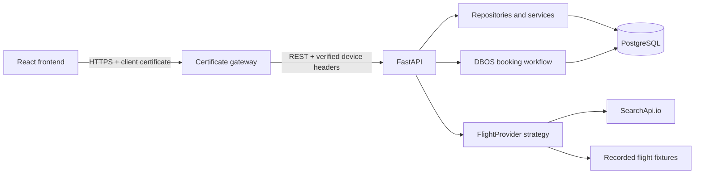

# Architecture

## System overview

TravelOps is deterministic application code; flight search uses the configured provider strategy.

## Main paths

- `POST /api/trips` validates airports and dates and creates a trip.
- `POST /api/trips/{trip_id}/flights/search` runs `FlightSearchService`, which owns provider
  selection, same-trip and cross-trip caching, persistence, cheapest-first ordering, and activity
  logging.
- Booking routes implement the `BookingState` finite state machine. DBOS wraps the external
  booking-options fetch and execution so retries are durable.
- Execution history is retained because flight searches record provider calls and outcomes. It is
  flight-search activity history, not model/tool planning history.

## Security boundaries

Every protected request passes session, tenant, role, device, ownership, and MFA policy at the
HTTP boundary. Decisions are persisted as append-only security events. Repeated denials trigger
automatic containment. The zero-trust compose deployment adds mutual TLS and private service
networks; only the gateway publishes a host port.

Slack remains a legacy, disabled-under-enforcement booking connector. It is outside the flight
search simplification.

## Provider strategy

`FlightProvider` has two implementations selected by `USE_LIVE_FLIGHT_API`: live SearchApi or
recorded real-response fixtures. Recorded mode replays captured offers; it does not fabricate
results. Search results are cached for 15 minutes and booking freshness is limited to 30 minutes.

## Persistence

Trips, flight results, booking logs/transitions, execution events, execution-run records, and security
evidence remain persisted. The `itinerary` table is removed by forward Alembic migration
`f6a7b8c9d012`; existing itinerary data is intentionally discarded because this is a disposable
demo and the feature no longer exists.

Security scope and remaining limits are documented in [ZERO_TRUST_FINDINGS.md](ZERO_TRUST_FINDINGS.md).
